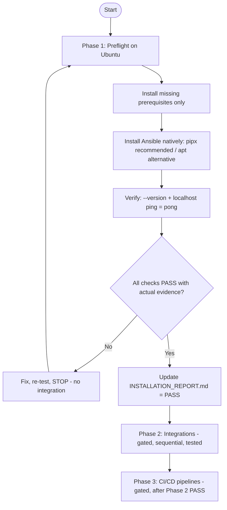

<div align="center">

# Ansible · Native Deployment on Ubuntu (Phased)

**Ansible on Ubuntu Server (native, not Docker) · Install → Verify → Integrate → CI/CD**

[](https://docs.ansible.com/)
[](https://ubuntu.com/server)
[](https://www.python.org/)

[Quick Start](#4-quick-start-phase-1) · [Phases](#3-phased-workflow) · [Verification](#6-verification--acceptance-gate) · [Integration](#7-phase-2--integration--playbooks-gated) · [Troubleshooting](#10-troubleshooting)

</div>

---

> **Important decision:** **Ansible is installed directly on the Ubuntu server (native), not inside Docker**, and it does not run as a persistent background service. Ansible manages the server itself and is used to provision/configure Docker, services, and containers.  
> **Organization only — nothing deleted.** Original (previously empty) files are preserved in [`legacy/`](legacy/).

## Contents

1. [Overview](#1-overview)
2. [Requirements](#2-requirements)
3. [Phased Workflow](#3-phased-workflow)
4. [Quick Start (Phase 1)](#4-quick-start-phase-1)
5. [Installation Methods (apt / pipx)](#5-installation-methods-apt--pipx)
6. [Verification & Acceptance Gate](#6-verification--acceptance-gate)
7. [Phase 2 — Integration & Playbooks (gated)](#7-phase-2--integration--playbooks-gated)
8. [Phase 3 — CI/CD Pipelines (gated)](#8-phase-3--cicd-pipelines-gated)
9. [Project Layout](#9-project-layout)
10. [Troubleshooting](#10-troubleshooting)
11. [Security & Rules](#11-security--rules)
12. [References](#12-references)

---

## 1. Overview

This repository provides a **clear, phase-gated** package for deploying **Ansible natively on Ubuntu** and, only after a verified installation, integrating it with infrastructure components (Docker, Traefik, Odoo 17/19, Jenkins) using independent, tested playbooks.

| Component | Runtime | Install method | State / evidence |
|---|---|---|---|
| Ansible (`ansible-core`) | **Native on Ubuntu** (not Docker) | `pipx` (recommended, isolated) or `apt` | `~/.local/bin` / system packages; evidence in `INSTALLATION_REPORT.md` |
| Python 3 | Native | Ubuntu packages | Required for Ansible |
| Integration stack (Phase 2) | Managed *by* Ansible | Roles/collections/playbooks (scaffold) | **GATED — not executed** |

**What this phase does now (Phase 1):** system preflight, install missing prerequisites only, install Ansible, run verification, record **actual** evidence.  
**What this phase does not do:** Jenkins/Docker/Traefik/Odoo integration, production playbooks, integration collections rollout, or any change to shared Docker/Traefik/Odoo configs.

## 2. Requirements

- Ubuntu Server 22.04/24.04 (or a compatible Ubuntu target) with network access for packages.
- `sudo` access to install **missing OS prerequisites only** (do **not** use `sudo` with `pipx install`).
- Python 3, Git, OpenSSH client.
- Recommended target path: **`/opt/InstallingAnsibleDeployment`**.

Preflight (no deletions):
```bash
lsb_release -a || cat /etc/os-release
python3 --version
ansible --version || echo "(not installed)"
pipx --version || echo "(pipx not found)"
git --version; ssh -V; echo "$PATH"
```

## 3. Phased Workflow



| Phase | Goal | Gate |
|---|---|---|
| **1. Installation** | Native Ansible on Ubuntu + verification only | **PASS required** in [`INSTALLATION_REPORT.md`](INSTALLATION_REPORT.md) before Phase 2 |
| **2. Integration & Playbooks** | Docker/Traefik/Odoo 17-19/Jenkins, independent & idempotent | Start only after Phase 1 PASS; test each component; staging first |
| **3. CI/CD** | Separate pipelines (Odoo 17/19 isolated) | After Phase 2 PASS; manual approval; no auto prod DB/module upgrade |

## 4. Quick Start (Phase 1)

> Run on the **target Ubuntu server**. Do not overwrite an existing `/opt/InstallingAnsibleDeployment` that contains data/config.

### 1 · Place the project under `/opt` (no overwrite)
```bash
# Option A: copy/clone the organized folder
sudo git clone <REPO_URL> /opt/InstallingAnsibleDeployment-src
sudo cp -a /opt/InstallingAnsibleDeployment-src/InstallingAnsibleDeployment /opt/InstallingAnsibleDeployment

# Option B: safe helper (refuses to overwrite an existing target)
sudo bash /path/to/InstallingAnsibleDeployment/01-Installation/scripts/deploy-to-opt.sh /opt/InstallingAnsibleDeployment
```

### 2 · Preflight (review only — no deletions)
```bash
cd /opt/InstallingAnsibleDeployment/01-Installation
chmod +x scripts/*.sh
bash scripts/preflight.sh
```
Review OS, Python, existing Ansible (keep current versions/config), `pipx`/Git/SSH, and `PATH`. **Do not remove or replace** existing installs without review.

### 3 · Install prerequisites and Ansible (recommended: `pipx`)
```bash
sudo apt update
sudo apt install -y python3 python3-pip python3-venv pipx git openssh-client sshpass ca-certificates curl

pipx ensurepath
source ~/.bashrc    # or reopen the SSH session
pipx install --include-deps ansible
```
> **Do not use `sudo` with `pipx install`.** Alternative (apt): `sudo apt install -y ansible` — record the method used.

### 4 · Verify and capture evidence
```bash
cd /opt/InstallingAnsibleDeployment
./VERIFY_INSTALLATION.sh          # writes verify-output.txt
```

### 5 · Record the gate
Update [`INSTALLATION_REPORT.md`](INSTALLATION_REPORT.md) and [`VERSION_INFO.md`](VERSION_INFO.md) with **actual** commands/output. Mark **PASS** only when every required check succeeds. **Stop here** until Phase 1 is PASS (and Phase 2 is explicitly requested).

## 5. Installation Methods (apt / pipx)

| Method | Command | Notes |
|---|---|---|
| **pipx (recommended)** | `pipx install --include-deps ansible` | Isolated user env; **no `sudo`**; run `pipx ensurepath` and reload shell/PATH |
| **apt (alternative)** | `sudo apt install -y ansible` | Uses Ubuntu repo version; simple; document version in report |
| **Helper script** | `bash 01-Installation/scripts/install-ubuntu.sh pipx` | Review before running; supports `apt` or `pipx` |

See [`INSTALLATION_GUIDE.md`](INSTALLATION_GUIDE.md) and [`InstallingAnsibleCommand.md`](InstallingAnsibleCommand.md) (Arabic, full command reference).

## 6. Verification & Acceptance Gate

**Required checks (record actual output):**
```bash
ansible --version
ansible-playbook --version
ansible-galaxy --version
python3 --version
ansible localhost -i localhost, -c local -m ping
```

**Expected ping:**
```text
localhost | SUCCESS => { "changed": false, "ping": "pong" }
```

**Acceptance (all required):**
- [ ] `ansible`, `ansible-playbook`, `ansible-galaxy` succeed.
- [ ] `python3` available/compatible.
- [ ] Local ping returns `pong` / `SUCCESS`.
- [ ] No critical Python/PATH errors; works in a new SSH session.
- [ ] [`INSTALLATION_REPORT.md`](INSTALLATION_REPORT.md) and [`VERSION_INFO.md`](VERSION_INFO.md) updated with real evidence.

> **Gate:** If any check fails, fix and re-test. **Do not start Phase 2.** Never claim an unexecuted test passed.

## 7. Phase 2 — Integration & Playbooks (gated)

> **Status: scaffold / NOT executed.** Location: [`02-Integration/`](02-Integration/). Proceed only after Phase 1 **PASS**.

Planned scope (inspect current state first; back up configs before changes; idempotent; staging first):
- **Ansible project:** `ansible.cfg`, inventories (`development`/`staging`/`production`), `group_vars`/`host_vars`, roles, `collections/requirements` (review/pin), templates, handlers, files, **Ansible Vault**.
- **Docker:** engine/compose, networks, containers, volumes, images, deploy, health/logs.
- **Traefik:** inspect & **back up current Traefik config before modification**; routing/TLS/Let’s Encrypt (Cloudflare DNS challenge if needed). No unreviewed shared changes.
- **Odoo 17 & 19 (strictly separated):** per-version configs/DBs/volumes/env; deploy, PostgreSQL, backups/restore, health. **No production DB/module upgrades without explicit approval + a verified restorable backup.**
- **Jenkins:** run playbooks with SSH/credentials, variables/inventory/env selection, logging, stop-on-failure; **least privilege** (no unnecessary root/Docker socket access).

**Independent playbooks (no monolith):** `system_preparation`, `docker_installation`, `docker_configuration`, `traefik_configuration`, `odoo17_deployment`, `odoo19_deployment`, `postgresql_management`, `backup`, `restore`, `health_check`, `maintenance` (see `02-Integration/playbooks/*.yml.example`).

## 8. Phase 3 — CI/CD Pipelines (gated)

After Phase 2 integrations pass: separate pipelines per project/environment/Odoo version (**17 and 19 isolated**). Typical flow: Checkout → Validation → Static Analysis → Dependency Validation → Tests → Build/Image → Backup Verification → Staging → Post-deploy Tests → **Manual Approval** → Production → Health Check → Report. **No automatic production deploy or DB/module upgrade.**

## 9. Project Layout

```text
InstallingAnsibleDeployment/
├── 01-Installation/                 # Phase 1 scripts (preflight/install/verify/deploy-to-opt)
│   └── scripts/
├── 02-Integration/                  # Phase 2 scaffold (GATED / not executed)
│   ├── ansible.cfg.example
│   ├── inventories/ (development|staging|production)
│   ├── playbooks/ (*.yml.example)
│   ├── roles/ (common,docker,traefik,odoo,postgresql,backup)
│   ├── collections/requirements.yml.example
│   ├── templates/ handlers/ files/ vault/ docs/ scripts/
│   └── jenkins/ docker/ traefik/ odoo/ playbooks/
├── legacy/                          # preserved original (empty) files — no deletions
├── INSTALLATION_GUIDE.md            # detailed Phase 1 steps
├── INSTALLATION_REPORT.md           # gate: actual evidence (PASS required)
├── VERSION_INFO.md                  # actual observed versions
├── VERIFY_INSTALLATION.sh           # Phase 1 verification wrapper
├── InstallingAnsibleCommand.md      # Arabic command reference
└── README.md
```

## 10. Troubleshooting

| Symptom | Check / fix |
|---|---|
| `ansible: command not found` after pipx | Run `pipx ensurepath`, then `source ~/.bashrc` or open a new SSH session; check `~/.local/bin` in `PATH` |
| Used `sudo pipx install` | Reinstall for the target user without `sudo`; fix PATH/ownership as appropriate (review first) |
| Local ping fails | Confirm `ansible` works (`--version`), Python 3 present, and use `-c local -i localhost,` |
| Different version than expected | Record actual version in `VERSION_INFO.md`; avoid replacing an existing install without review |
| Phase 2 config uncertainty | **Stop** — Phase 2 is gated; inspect/backup current state and test in staging first |

## 11. Security & Rules

- **Native, not Docker:** Ansible runs on Ubuntu; no Ansible-in-Docker/service in Phase 1.
- **No deletions / preserve state:** keep `legacy/`; do not delete files, folders, data, volumes, keys, or configs without review.
- **Minimal changes:** install missing prerequisites only; preserve existing versions/configs.
- **Secrets:** never commit secrets. Use Ansible Vault / Jenkins Credentials; protect inventory/logs.
- **Production safety:** no unreviewed shared Docker/Traefik/Odoo changes; back up Traefik/current configs before modification. No production or DB/Odoo module upgrades without explicit approval + restorable backup.
- **Truthful reporting:** record real commands/output; never claim unexecuted tests passed.

## 12. References

- [Ansible documentation](https://docs.ansible.com/)
- [Ansible installation guide](https://docs.ansible.com/ansible/latest/installation_guide/index.html)
- [Ansible with pipx](https://docs.ansible.com/ansible/latest/installation_guide/intro_installation.html)
- [Repository: InstallingAnsibleDeployment](https://github.com/abdalazeim/InstallingAnsibleDeployment)

---
**Next action (Phase 1):** run on the Ubuntu target, complete verification, and update [`INSTALLATION_REPORT.md`](INSTALLATION_REPORT.md) to **PASS** with evidence — only then proceed to Phase 2 (separate request).